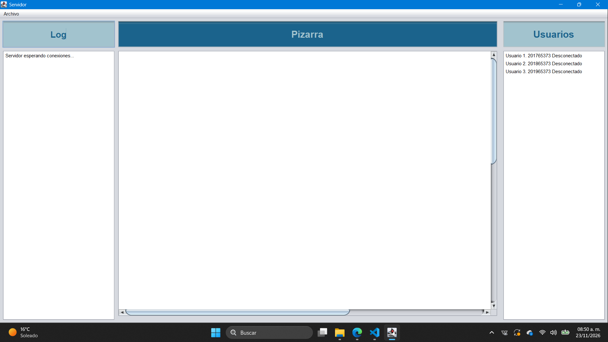
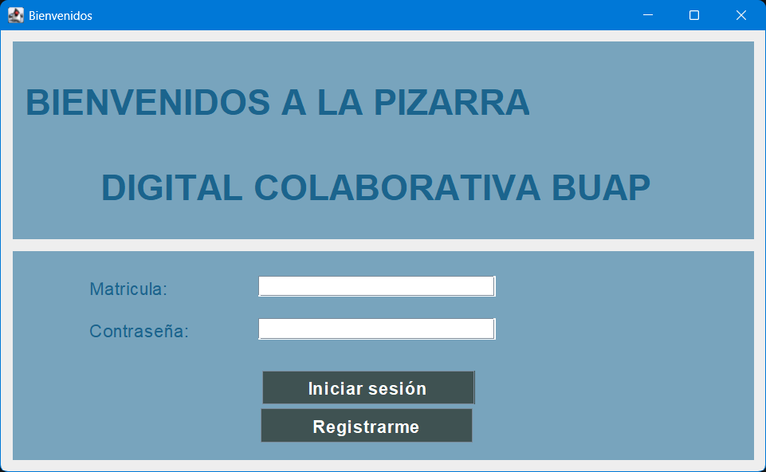
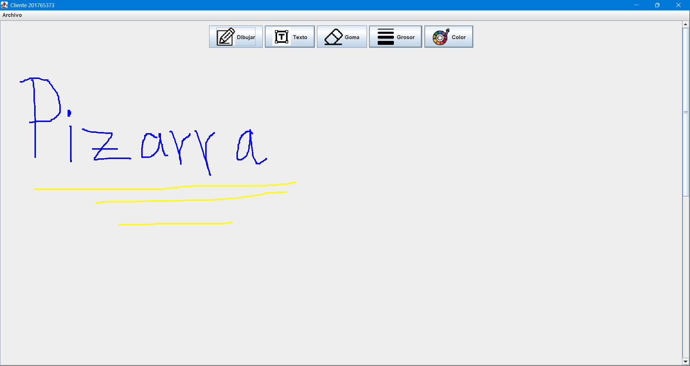
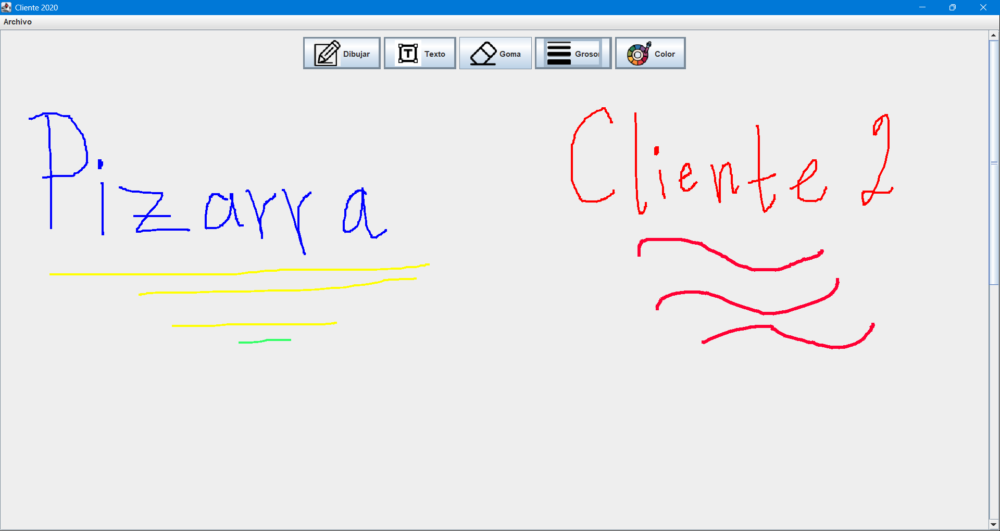
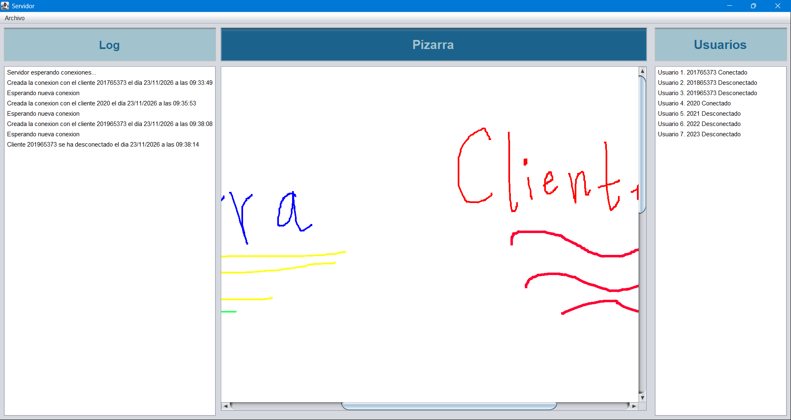

# Pizarra colaborativa

Aplicación de escritorio desarrollada en Java que permite a múltiples usuarios conectarse y trabajar simultáneamente en una pizarra compartida en tiempo real.

El sistema utiliza una arquitectura cliente-servidor, comunicación mediante sockets TCP y programación multihilo para gestionar conexiones simultáneas y sincronizar las acciones de los usuarios.

## Características

- Registro de usuarios e inicio de sesión.
- Comunicación cliente-servidor mediante sockets TCP.
- Dibujo colaborativo en tiempo real.
- Herramientas para dibujar, borrar y agregar texto.
- Personalización de colores y grosor de los trazos.
- Gestión de múltiples clientes mediante hilos y concurrencia.
- Visualización de usuarios conectados y desconectados.
- Registro del historial de sesiones en MySQL.

## Tecnologías utilizadas

- **Java:** lenguaje de programación.
- **Java Swing:** desarrollo de interfaces gráficas.
- **Sockets TCP:** comunicación entre cliente y servidor.
- **Multithreading:** gestión de conexiones simultáneas.
- **MySQL:** almacenamiento de usuarios e historial de conexiones.
- **JDBC:** conexión entre Java y MySQL.
- **Apache Ant:** configuración y compilación de los proyectos.

## Estructura del proyecto

```text
ProyectoConcurrente/
├── BaseDeDatos/
│   └── pizarra.sql
├── Cliente/
│   ├── src/
│   ├── nbproject/
│   ├── build.xml
│   └── manifest.mf
├── Servidor/
│   ├── src/
│   ├── nbproject/
│   ├── build.xml
│   └── manifest.mf
├── lib/
│   └── mysql-connector-j-26.10.0.jar
├── screenshots/
│   ├── Server.png
│   ├── InicioSesion.png
│   ├── interfaz.png
│   ├── interfaz2.png
│   └── ServerConClientes.png
├── .gitignore
├── LICENSE
└── README.md
```

## Requisitos

- Java JDK.
- MySQL Server.
- Entorno compatible con proyectos Java y Apache Ant.
- Puerto TCP 5000 disponible para la comunicación entre clientes y servidor.

## Configuración

1. Clonar el repositorio:

   ```bash
   git clone https://github.com/FerGadeaS/pizarra-colaborativa-java.git
   ```

2. Importar el archivo `BaseDeDatos/pizarra.sql` en MySQL.

   **Importante:** el script recrea las tablas y procedimientos almacenados del proyecto. Utilízalo en una base de datos de prueba, ya que puede eliminar datos existentes en esas tablas.

3. Configurar las variables de entorno para la conexión a MySQL en Windows:

   ```cmd
   setx PIZARRA_DB_USER "usuario_mysql"
   setx PIZARRA_DB_PASSWORD "contraseña_mysql"
   ```

   Sustituir los valores por las credenciales de la instalación local de MySQL. Reiniciar el IDE o la terminal después de configurar las variables.

4. Verificar que MySQL Connector/J esté incluido en las dependencias del proyecto.

5. Abrir los proyectos `Cliente` y `Servidor` en el entorno de desarrollo y comprobar que compilan correctamente.

## Ejecución

1. Iniciar el servicio de MySQL.
2. Ejecutar el proyecto `Servidor`.
3. Ejecutar uno o varios clientes.
4. Registrar una cuenta o iniciar sesión.
5. Comenzar a utilizar la pizarra colaborativa.

El servidor debe estar ejecutándose antes de iniciar las conexiones de los clientes.

## Capturas de pantalla

### Interfaz del servidor



### Inicio de sesión y registro



### Interfaz de la pizarra



### Trabajo simultáneo de varios clientes



### Servidor con varios clientes conectados



## Demostración

[Ver demostración en YouTube](https://youtu.be/GfCalODNAsk)

## Autor

**Desarrollado por Luis Fernando Gadea Sánchez**

[GitHub: FerGadeaS](https://github.com/FerGadeaS)

Proyecto académico desarrollado como parte de mi formación en Ciencias de la Computación.

## Licencia

Este proyecto está disponible bajo la licencia MIT. Consulta el archivo `LICENSE` para más información.